I read [Filesystem-Based Memory for LLM Agents: Organization, Evolution, and Sustainability](https://arxiv.org/abs/2607.26637), discussed when memory curation is useful, and ran a small follow-up experiment to explore how its value depends on the model and task.

[Watch on YouTube](https://youtu.be/kzF8COXWpe4) · [Open the PDF](../../assets/blog/when-is-memory-curation-worth-it/slides.pdf)

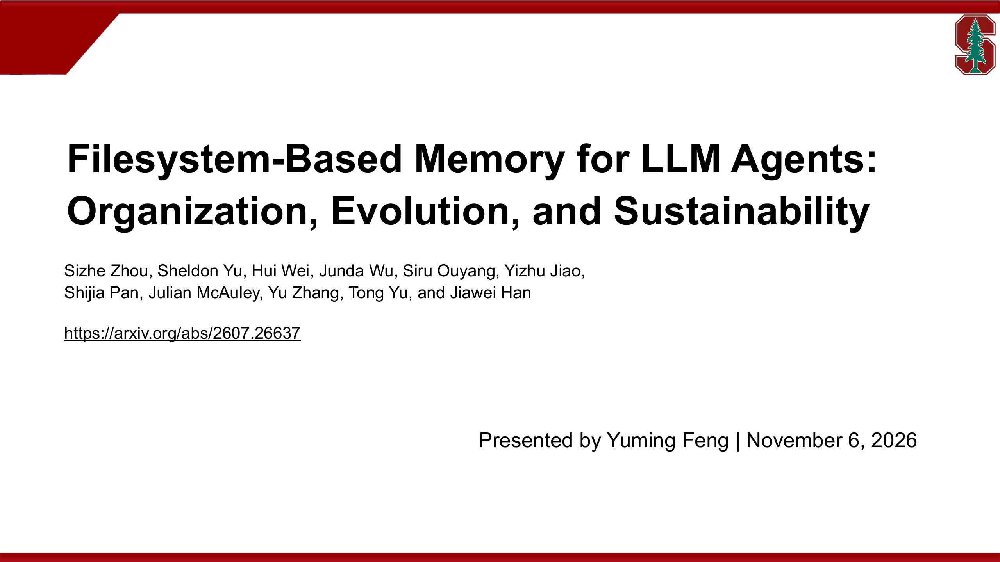

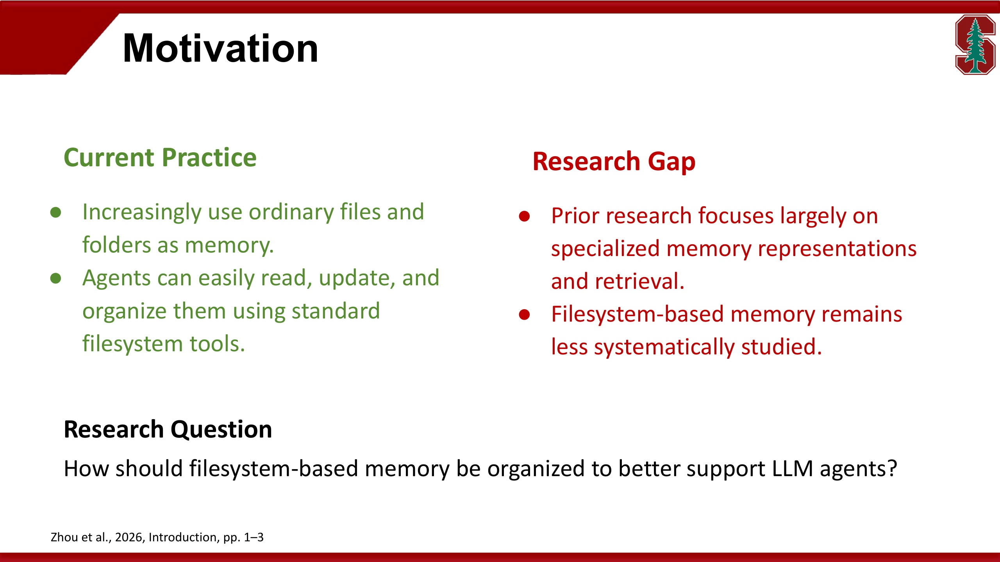

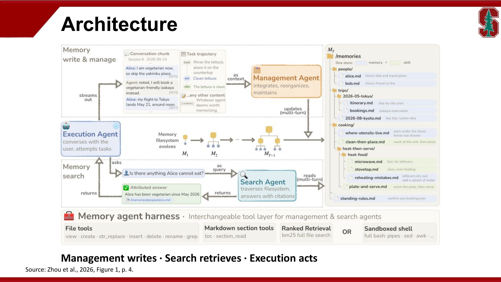

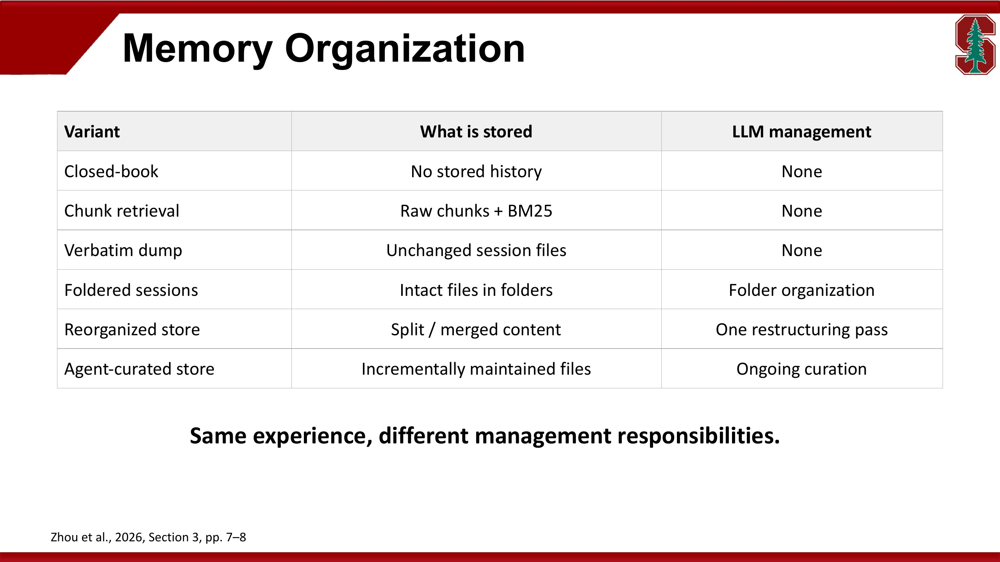

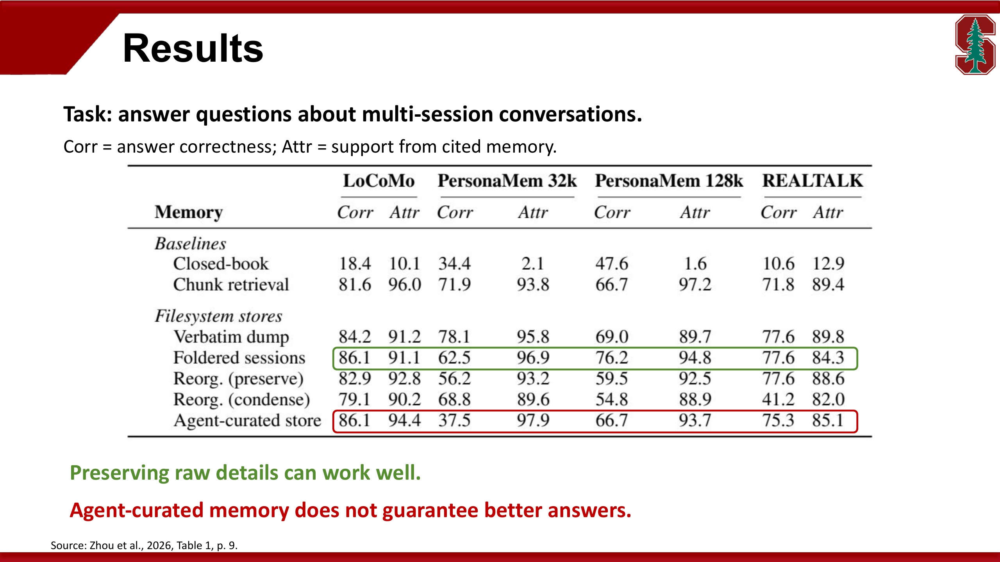

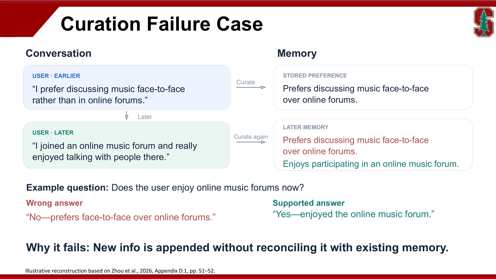

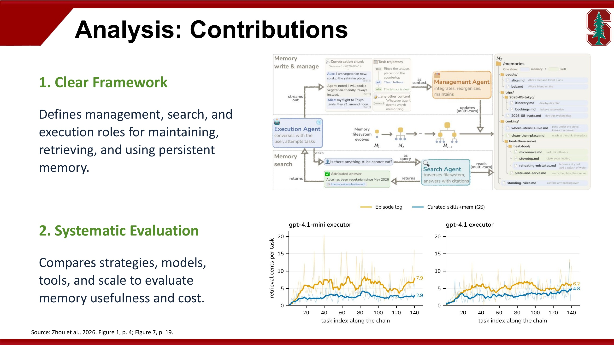

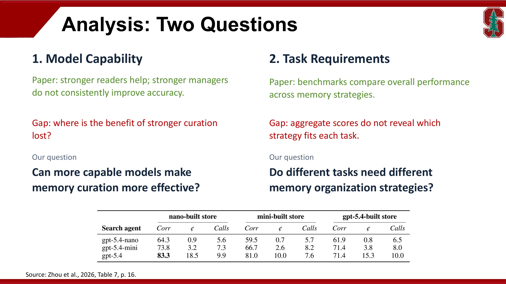

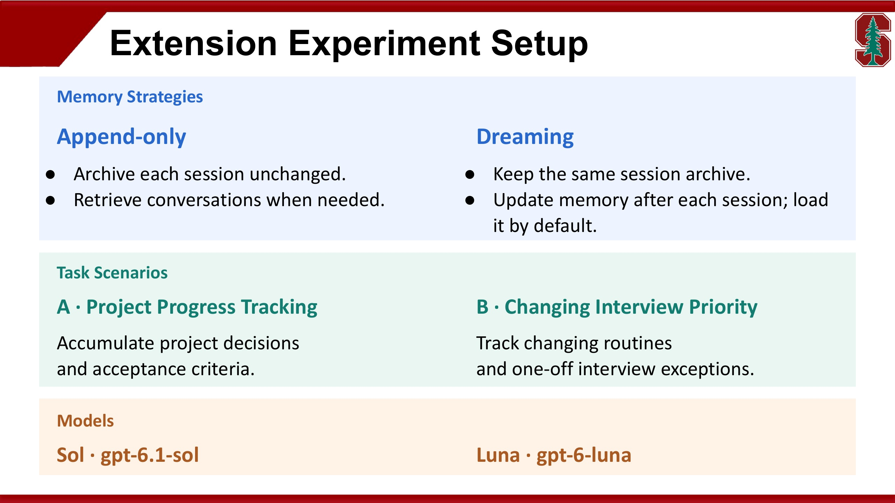

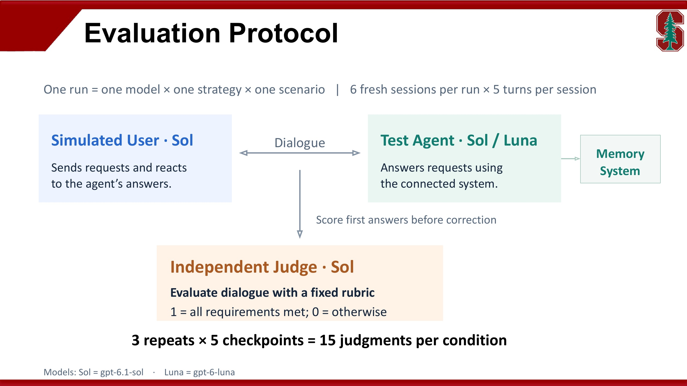

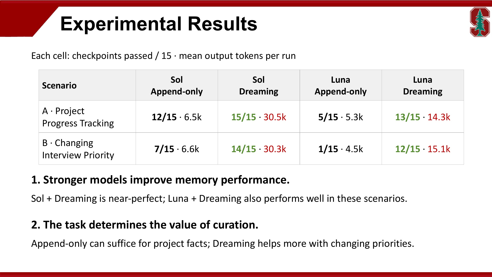

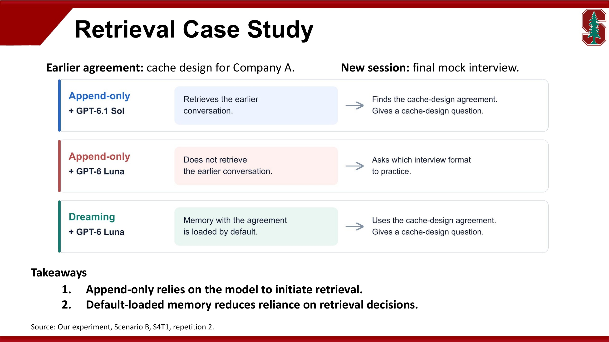

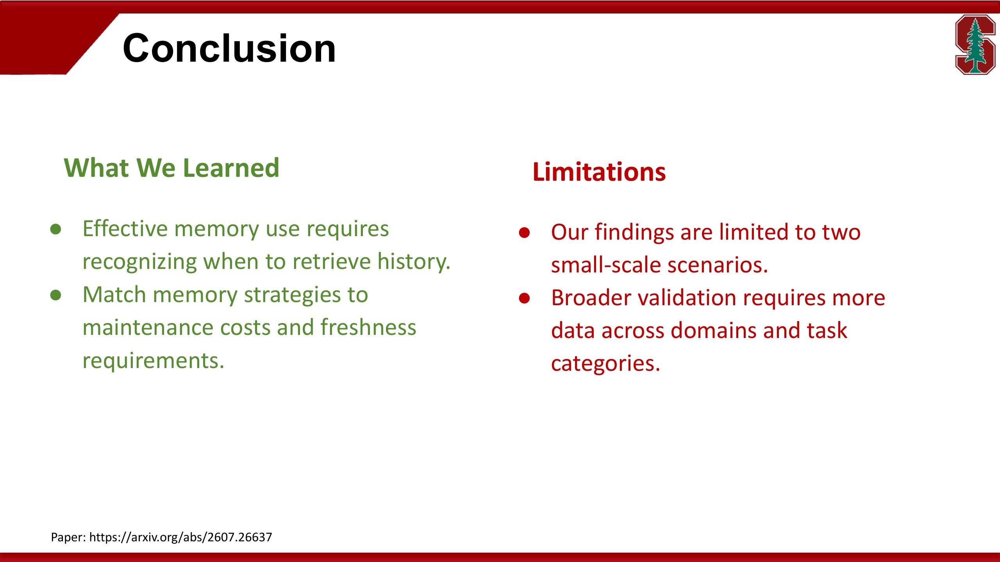
